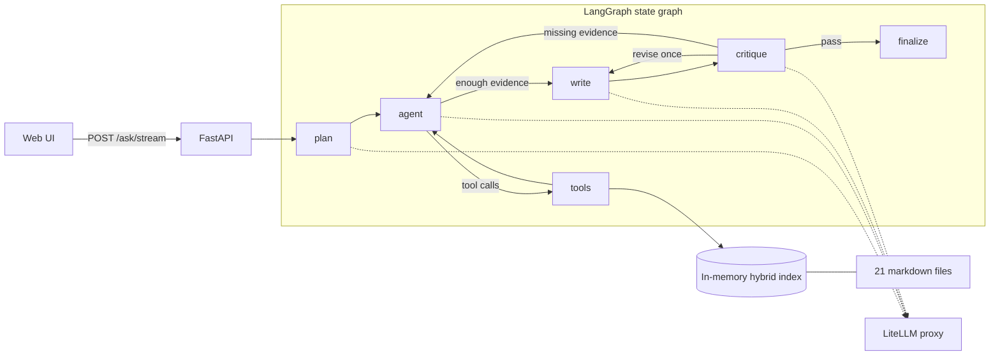

# Drug label research agent

An agentic research assistant that answers compound pharmacology questions using only a local corpus
of 21 documents: 10 FDA drug labels (DailyMed), 10 MedlinePlus patient leaflets and a glossary.
Every sentence of an answer is cited, every claim is checked against its source before the answer is
shown, and every answer carries a "not medical advice" disclaimer.

Built for the Syntax Systems GenAI Bootcamp coding assignment (November 2026).

## Quick start

```bash
cp .env.example .env          # then fill in your LiteLLM key, base URL and model names
docker build -t agent .
docker run -p 8000:8000 --env-file .env agent
```

- Web interface: http://localhost:8000
- Health check: `curl http://localhost:8000/health`
- Question: `curl -X POST http://localhost:8000/ask -H "Content-Type: application/json" -d '{"question": "What are the main contraindications for warfarin?"}'`
- Interactive API documentation: http://localhost:8000/docs

The container builds its search index at startup (about 10 seconds, 500 embeddings). `/health`
answers only once the index is ready, so a 200 on `/health` means `/ask` is ready too.

## What the agent does

| Assignment step | How it is done |
| --- | --- |
| Plan | The LLM turns the question into a typed plan (question type, drugs, sub-questions, answer language), validated by Pydantic. |
| Retrieve | Hybrid in-memory search: BM25 + embeddings (numpy cosine), fused with Reciprocal Rank Fusion, filterable by drug, section and source. |
| Use tools | Six local tools exposed through native function calling. The model chooses which tools to call; nothing is hardcoded. |
| Review | A deterministic check rejects citations that match no retrieved passage, then an LLM critic labels every claim as supported, unsupported or ambiguous. One rewrite is allowed, or one more research round if evidence is missing. |
| Answer | Markdown answer with numbered citations (file, section, excerpt), the critic's verdict and flags, and a disclaimer added by code in the answer's language. |

## Architecture



| Node | Work done by | Role |
| --- | --- | --- |
| `plan` | LLM, strict JSON | Question type, drugs, sub-questions, language |
| `agent` | LLM, function calling | Chooses the tools; at least one tool call is required on the first turn |
| `tools` | Code | Runs the calls and keeps every passage read as evidence |
| `write` | LLM | Writes the answer, citing passage ids only |
| `critique` | Code, then LLM | Rejects unknown citations, then checks each claim |
| `finalize` | Code | Numbers citations, lists sources, adds the disclaimer |

Loops are bounded: 6 research steps, 1 rewrite, 1 return to research.

## Tools

| Tool | What it does |
| --- | --- |
| `search_corpus` | Hybrid search with optional drug, section and source filters |
| `get_section` | Returns a whole section of one label, e.g. warfarin contraindications |
| `find_interactions` | Finds what each drug's label says about the other drug **or its class** (the warfarin label lists "serotonin reuptake inhibitors", not "Zoloft") |
| `compare_sections` | The same section for several drugs, side by side |
| `lookup_glossary` | Definitions from the corpus glossary |
| `check_lab_threshold` | Extracts numeric thresholds (e.g. metformin eGFR) and compares the patient's value **in code** |

Drug names are resolved from brand names and synonyms found in the corpus (Coumadin, Eliquis, Zoloft,
paracetamol...), plus a few common brands and French names.

## Design decisions

| Decision | Why | Alternative considered |
| --- | --- | --- |
| Official `openai` SDK against the LiteLLM proxy | The model is just an environment variable; full control over tool calling and structured outputs | LangChain chat models: an extra abstraction layer |
| LangGraph for orchestration | The workflow is a graph with conditional loops; typed state, bounded loops, per-node streaming to the UI | A hand-written loop (simple, but less explicit); CrewAI or AutoGen (less predictable) |
| Section-aware chunking with metadata | Label sections are the natural unit of meaning; metadata enables filters and precise citations | Fixed-size chunks that cut sections in half |
| Hybrid BM25 + embeddings with RRF | Exact terms (eGFR, INR, drug names) need lexical search; RRF fuses rankings without tuning weights | Embeddings only; a vector database (unnecessary for 500 passages) |
| Deterministic tools and checks | Facts, numbers and citations are verified by code, which cannot hallucinate | Asking the LLM to "double-check" |
| Disclaimer added by code | Present in 100 % of answers, whatever the model does | Asking the model to add it |
| No-build frontend served by FastAPI | One container, no CDN, no extra process | Streamlit or Gradio |

## Robustness

- The `.env` provided with the assignment names the base URL `OPENAI_BASE_UR`. Both names are accepted.
- `docker run --env-file` keeps quotes around values; they are stripped.
- If the model rejects strict JSON schemas, structured outputs fall back to JSON mode plus Pydantic validation.
- If embeddings are unavailable, search falls back to BM25 only and `/health` reports it.
- An unreachable LLM returns HTTP 502 with a readable message, or an `error` event on the stream.
- Embeddings are cached on disk, keyed by model name and corpus content.

## Evaluation

```bash
uv run python -m eval.run_eval                               # in-process agent
uv run python -m eval.run_eval --url http://localhost:8000   # against the running container
```

`eval/questions.json` holds the 4 public questions and 8 extra ones written to resemble hidden
questions: an interaction, a mechanism, a maximum dose, a contrast-imaging rule, an allergy, an
aggregation over a table, an out-of-corpus drug and a question in French. Each case lists the files
that must be cited and the key facts (regular expressions) the answer must contain. Scores are
computed by code. Latest results: [eval/results/latest.md](eval/results/latest.md).

## API

| Method | Path | Body | Response |
| --- | --- | --- | --- |
| GET | `/health` | | `{"status": "ok", "model", "passages", "drugs", "semantic_search"}` |
| POST | `/ask` | `{"question": "..."}` | Answer, citations, plan, tool calls, review, disclaimer, run metadata |
| POST | `/ask/stream` | `{"question": "..."}` | Server-Sent Events: one `step` event per graph node, then `result` |
| GET | `/` | | Web interface |

## Configuration

| Variable | Required | Default | Meaning |
| --- | --- | --- | --- |
| `OPENAI_API_KEY` | yes | | LiteLLM key |
| `OPENAI_BASE_URL` | yes | | LiteLLM proxy URL (`OPENAI_BASE_UR` also accepted) |
| `OPENAI_MODEL` | yes | | Chat model |
| `OPENAI_EMBEDDING_MODEL` | no | `text-embedding-3-small` | Embedding model |
| `LLM_TEMPERATURE` | no | not sent | Some reasoning models reject this parameter |
| `LLM_REASONING_EFFORT` | no | not sent | e.g. `low` to reduce latency on reasoning models |
| `AGENT_MAX_STEPS` | no | `6` | Maximum research steps |
| `LOG_LEVEL` | no | `INFO` | Log level |

## Local development

```bash
uv sync                                          # Python 3.11, dependencies pinned in uv.lock
uv run uvicorn app.main:app --reload --port 8000
uv run pytest                                    # 58 tests, no network access needed
uv run python -m scripts.ask "Your question"     # the agent in the terminal
uv run python -m scripts.check_llm               # what the configured model supports
```

Tests replace the LLM and the embeddings with deterministic fakes, so they run offline in about
two seconds.

## Project structure

```text
app/
  config.py          settings from environment variables
  llm.py             OpenAI SDK client: chat, strict JSON with fallback, embeddings
  ingest/            markdown parsing into categorised sections, then chunks
  retrieval/         BM25, embeddings cache, hybrid index with RRF
  agent/
    graph.py         LangGraph graph: plan, agent, tools, write, critique, finalize
    tools.py         the six tools and their JSON schemas
    drugs.py         brand names, synonyms and drug classes
    thresholds.py    numeric threshold extraction and comparison
    citations.py     citation checks, renumbering, disclaimer
    prompts.py       all prompts in one place
    schemas.py       Pydantic models (plan, review, result)
  main.py            FastAPI app
  static/            web interface (HTML, CSS, JavaScript, no build step)
corpus/              the 21 provided documents
eval/                evaluation questions, script and results
scripts/             command-line helpers
tests/               unit and API tests with fake LLM and embeddings
```

Code comments and docstrings are written in French. Prompts are in English, the language of the
corpus; answers follow the language of the question.

## Limitations and next steps

- The critic uses the same model as the writer; a different model would reduce shared blind spots.
- A cross-encoder reranker would sharpen retrieval, at the cost of a larger image.
- Latency is 10 to 40 seconds per question (5 to 7 LLM calls); streaming keeps the interface responsive.
- The stemmer is a minimal suffix stripper tuned for English label vocabulary.
- Evaluation checks facts with regular expressions; an LLM judge could assess fluency and completeness.
- No authentication or rate limiting: this is a demonstration service.

## AI assistance

AI assistance was used throughout, as the assignment allows. See [AI_USAGE.md](AI_USAGE.md) for how,
and [CLAUDE.md](CLAUDE.md) for the instructions given to the coding assistant.
